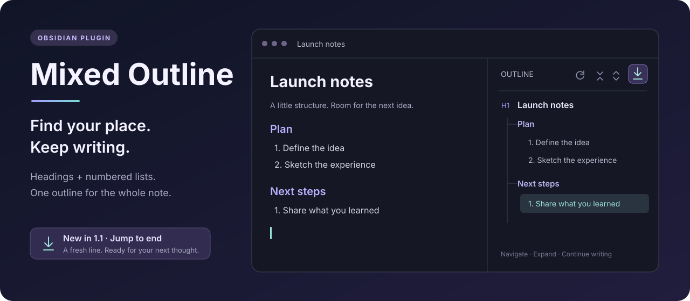

<p align="center">
  
</p>

<p align="center">
  <a href="https://github.com/hemashishi12/mixed-outline/releases/latest"></a>
  <a href="LICENSE"></a>
  
  
</p>

<p align="center">
  <b>Headings and numbered lists, together in one navigable outline.</b><br>
  Click anywhere in your note. Your outline follows.
</p>

<p align="center">
  <a href="#installation">Install</a> ·
  <a href="#follow-your-cursor">Follow your cursor</a> ·
  <a href="CHANGELOG.md">What's new</a> ·
  <a href="README.zh-CN.md">简体中文</a>
</p>

---

## Why Mixed Outline?

Your ideas do not always fit inside headings. Reading notes, project plans, study guides, and long drafts often carry their structure in numbered lists too. Mixed Outline brings both into a single sidebar tree, so you can navigate the way you actually write.

## What's new in 1.4.0

- **Choose one outline mode.** **Outline mode / 大纲模式** offers **Remember manual folding per file / 按文件记住手动折叠** (default for new installations), **Follow cursor / 跟随光标**, **Follow scroll / 跟随滚动**, and **Follow cursor and scroll / 同时跟随光标与滚动**. Remember mode restores each note's manual expansion/collapse after switching notes, reopening the sidebar, or restarting Obsidian.
- **Complete mixed-list outlines.** Ordered siblings remain visible after blank lines, continuation paragraphs, unordered details, or task lists. Hidden branches and fenced/indented code remain excluded.
- **Navigate in Reading view.** Clicking an entry scrolls the rendered note while preserving Reading view. The navigation fix incorporates the problem identified in [PR #3](https://github.com/hemashishi12/mixed-outline/pull/3), using Obsidian's public view-state API instead of block-relative DOM line markers.
- **Use all four modes in Reading view.** Cursor following responds to clicks and text selections in the rendered note; scroll following tracks the visible section, and remember mode keeps your manual folds.

Existing follow preferences and hotkeys are preserved. New installations default to remembered manual folding; notes without saved folds initially expand the outermost entries and collapse deeper branches. See the [1.4.0 release notes](https://github.com/hemashishi12/mixed-outline/releases/tag/1.4.0) or [full changelog](CHANGELOG.md).

## What's new in 1.3.0

- **Jump to the top.** The first toolbar button now moves to the start of the note and focuses the editor without changing its text. It replaces Refresh; manual refresh remains in the command palette.
- **Customize both navigation hotkeys.** Open **Settings → Hotkeys**, search **Mixed Outline**, and bind **Jump to start / 滚动到顶部** and **Jump to end / 跳转到最后（滚动到底部）** separately.
- **Keep your existing shortcuts.** The end command retains its ID and existing hotkeys, including its append-one-newline behavior.

Existing settings are preserved. See the [release notes](https://github.com/hemashishi12/mixed-outline/releases/tag/1.3.0) or [full changelog](CHANGELOG.md).

## Features

| Feature | What it does |
| --- | --- |
| **One connected outline** | Combines Markdown headings and numbered list items, including nested lists. |
| **Click to navigate** | Takes you to the matching line in the note. |
| **Follow your cursor** | Expands the current branch as you edit, or click/select text in Reading view. |
| **Jump to start** | Moves to the top and focuses the first character without changing the note. |
| **Jump to end ✨** | Moves to the bottom, focuses the editor, and leaves an empty line ready for writing. |
| **Custom navigation hotkeys** | Assign separate start/end shortcuts in Obsidian's Hotkeys settings. |
| **Follow your reading** | Optional scroll sync expands the current path and highlights your position. |
| **Keep the tree tidy** | Collapse or expand the outline with a single click. |
| **Remember manual folding** | Optionally keep separate expansion/collapse preferences for each note. |
| **Stay up to date** | Refreshes as you edit or switch notes. |

The illustration above uses fictional sample content. No personal vault screenshots are included.

## Installation

### From Obsidian

1. Open **Settings → Community plugins → Browse**.
2. Search for **Mixed Outline**, install it, and enable it.
3. Click the **Open Mixed Outline** ribbon icon, or run **Mixed Outline: Open mixed outline** from the command palette.

Already installed? Open **Settings → Community plugins → Check for updates** and update Mixed Outline.

### Manual installation

Download `main.js`, `manifest.json`, and `styles.css` from the [latest release](https://github.com/hemashishi12/mixed-outline/releases/latest). Place all three in `<your-vault>/.obsidian/plugins/mixed-outline/`, reload Obsidian, and enable the plugin. Preserve `data.json` when upgrading; it contains your settings.

Requires **Obsidian 1.5.0+**. The plugin uses Obsidian and its bundled CodeMirror APIs, with no Node.js or Electron runtime dependencies. Desktop and mobile are declared supported; version 1.4.0 was verified in desktop Obsidian, while mobile and the minimum supported Obsidian version have not been separately tested.

## Follow your cursor

Choose how the outline responds in the single **Outline mode / 大纲模式** dropdown:

| Mode | Behavior |
| --- | --- |
| **Remember manual folding per file / 按文件记住手动折叠** (default) | Restore each note's manual expansion/collapse; cursor movement, Reading-view clicks/selections, and scrolling leave it as you arranged it. |
| **Follow cursor / 跟随光标** | Follow the editing cursor, or clicks and text selections in Reading view. |
| **Follow scroll / 跟随滚动** | Follow the visible section in editing and Reading views. |
| **Follow cursor and scroll / 同时跟随光标与滚动** | Follow the cursor or Reading-view clicks/selections, plus the visible section. |

In **Live Preview** or **Source mode**, click a heading, numbered item, or paragraph. Mixed Outline highlights the corresponding entry, expands it and its ancestors, and collapses unrelated branches. Selecting a parent heading or list item reveals its direct children. Arrow keys and text edits work the same way; no scroll is required.

For ordinary paragraphs, the preceding heading or numbered item determines the current outline entry. Before the first entry, there is nothing to highlight.

In **Reading view**, cursor following uses the place you click or select in the rendered note. Clicking a heading or numbered item, or selecting its text, highlights the corresponding outline entry and expands its branch. Scroll-only following responds to scrolling; combined following responds to both. These interactions keep the note in Reading view.

New installations default to **Remember manual folding per file / 按文件记住手动折叠**. All four modes work in editing and Reading views; choose a following mode whenever you want the outline to respond automatically.

Upgrades preserve a valid selected mode and existing remembered folds. An older remember-mode setting stays in remember mode; otherwise existing cursor/scroll preferences map to the corresponding mode, including both when both were enabled. If both were off, or no previous mode/follow settings exist, the plugin uses remember mode. The new-installation default does not override existing follow preferences.

To expand and collapse the tree by hand and keep your choices across sessions, select **Remember manual folding per file / 按文件记住手动折叠**.

Manual preferences are local to the vault and stored in the plugin's `data.json`. File and folder renames move the saved preferences; deleting a note or folder removes its preferences. Identities use the ancestor path, a hash of the original label, and an occurrence index rather than source line numbers, so inserting preceding lines or changing display truncation does not move the saved state to another entry. Renaming or reparenting an outline entry creates a new identity; adding indistinguishable duplicate siblings can change their occurrence indices.

Following never writes manual fold preferences. Switching back to remember mode restores the previous manual choices. The **Toggle scroll following / 切换滚动跟随** command switches **remember ↔ scroll** or **cursor ↔ both**. Turning off scroll-only following returns to remember mode. Its existing command ID and assigned hotkeys are preserved.

## Jump to start and end

Click the **up arrow above a horizontal line**, the first button in the outline toolbar, to **滚动到顶部 / Jump to start**. It replaces the Refresh button, moves to line 1, column 1, and focuses the editor without changing the note. Reading view switches to editing first. Manual refresh remains available as **Mixed Outline: Refresh mixed outline** in the command palette.

### Custom hotkeys

Open **Settings → Hotkeys** and search for **Mixed Outline**. Assign or change shortcuts for:

- **Jump to start / 滚动到顶部**
- **Jump to end / 跳转到最后（滚动到底部）**

Both commands use Obsidian's standard hotkey editor and have no default binding. The existing `mixed-outline:jump-to-end` command ID is unchanged, so previously assigned shortcuts are preserved. They also work from the command palette when the outline sidebar is closed. Both toolbar buttons are disabled when no Markdown note is available.

### Jump to end

Click the **down arrow above a horizontal line**, the last button in the outline toolbar. Its tooltip is **跳转到最后 / Jump to end**.

The button brings the current note into editing mode, scrolls the final cursor position into view, and focuses the editor so you can start typing immediately.

- If the note ends with text, one newline is appended.
- If an empty final line already exists, the cursor moves there. Repeated clicks do not accumulate blank lines.
- Empty notes are ready to type into without inserting extra lines.
- Reading view switches to editing first. Live Preview and Source mode remain editable.
- Existing text, including selected text and the contents of a final list item, is preserved.

The command palette and its custom hotkey perform the same action as the toolbar button.

## A small example

```markdown
# Launch notes
## Plan
1. Define the idea
2. Sketch the experience
   1. Keep the outline clear
   2. Make writing effortless
## Next steps
1. Share what you learned
```

The headings and numbered items appear together. Nested list items sit beneath their parent, and each entry links back to its source line.

### How headings and lists fit together

```markdown
# Project
1. First step
   1. Detail
### Next section
1. Next step
```

```text
Project
├─ 1. First step
│  └─ 1. Detail
└─ Next section
   └─ 1. Next step
```

A list belongs to the preceding heading. A later heading uses the heading hierarchy, never the preceding list as its parent. This also applies to skipped heading levels: `Next section` remains beside `First step`. A list before the first heading stays at the root alongside that heading.

Mixed Outline recognizes ATX headings (`#` through `######`) and ordered list markers such as `1.` or `2)`. It skips YAML frontmatter, fenced code blocks, unordered lists, and task lists. Ordered items nested inside hidden unordered or task lists are also omitted.

## Settings & commands

| Setting | Default | Purpose |
| --- | --- | --- |
| Show headings | On | Include Markdown headings. |
| Show ordered lists | On | Include numbered Markdown list items. |
| Strip Markdown formatting | On | Simplify inline formatting in outline labels. |
| Maximum item length | 160 | Limit label length, from 20 to 500 characters. |
| Open on startup | Off | Open the sidebar when Obsidian starts. |
| Outline mode / 大纲模式 | Remember manual folding per file / 按文件记住手动折叠 | Choose remembered manual folding, cursor following, scroll following, or both. |

Available commands: **Open mixed outline**, **Refresh mixed outline**, **Jump to start / 滚动到顶部**, **Jump to end / 跳转到最后（滚动到底部）**, and **Toggle scroll following / 切换滚动跟随**.

## Privacy

Mixed Outline processes note content locally. It makes no network requests, collects no telemetry, and needs no account. Its settings and optional per-file fold preferences are stored in the vault's plugin `data.json`; fold keys contain hashes rather than raw note labels. Jump to end edits only the targeted note and only appends a newline when needed.

## Development

This is a small, directly editable JavaScript plugin. **There is no build step or dependency installation.**

```sh
git clone https://github.com/hemashishi12/mixed-outline.git
cd mixed-outline
node --check main.js
node --test
```

Use Node.js 18+ for the tests. Copy the three plugin files into a development vault and reload the plugin to try changes.

Verification for 1.4.0: **150 automated tests passed**, including 25 Reading-view tests and the existing hierarchy test's 37 cases, plus **40 independent desktop Obsidian checks**. Desktop checks cover all four modes, nested-list clicks with frontmatter, forward/reverse selections, cursor-only and scroll-only isolation, combined following with PageDown, Reading-view outline navigation, remembered folds, plugin reload with existing preview DOM, view/note switches, renaming, paragraph selection, links and checkboxes, embedded-note isolation, unchanged note content, and protection of saved manual folds. Mobile and the minimum supported app version have not been separately tested.

| File | Purpose |
| --- | --- |
| `main.js` | Plugin lifecycle, parser, outline UI, navigation, and settings. |
| `styles.css` | Theme-aware sidebar styling. |
| `manifest.json` | Plugin identity, version, and minimum Obsidian version. |
| `versions.json` | Release compatibility mapping. |
| `test/` | Navigation, cursor synchronization, and hierarchy regression tests using Node's built-in test runner. |
| `tests/hierarchy.cjs` | Reusable checks for 37 heading/list hierarchy cases, scroll paths, and numbering. |

Implementation notes:

- Reading view must switch to `source` view state before placing an editable caret. This state covers both Source mode and Live Preview.
- Outline entry navigation preserves Reading view with `leaf.setEphemeralState({ line, focus: true })`; Obsidian delays preview scrolling until rendering is ready. Read its document scroll position from `view.getEphemeralState().scroll`, not the hidden editor or block-relative `data-line` attributes.
- For Reading-view clicks/selections, get the current absolute section bounds from the Markdown postprocessor's `ctx.getSectionInfo(element)`. A list item's `data-line` is relative to that section; validate its offset before adding `lineStart`. Match the active note and ignore embedded content so another note's rendered text cannot drive this outline.
- Retain the `TFile` reference for Reading-view contexts/listeners so renaming the note does not leave a stale path. Use `selectionchange` for keyboard selection; a PageDown `keyup` can still expose an older selection, so it must not overwrite the scroll-follow position.
- Keep hidden list frames in the parser's ancestry. Blank lines and list-continuation blocks do not end a list; actual dedents do. Measure nested content and code indentation from marker content columns, including multi-digit markers and tab stops.
- Persist manual fold states separately from follow-driven UI state. Serialize settings/fold snapshots to prevent slow older writes from overwriting newer actions, and reject stale asynchronous renders after a file switch.
- Keep `outlineMode` as the only source of mode state; read legacy behavior/follow fields only during settings migration. New installations default to `remember`. When changing modes, immediately cancel pending cursor work and timers and detach the scroll listener before awaiting the settings write, so delayed events cannot apply the previous mode.
- Use `editor.replaceRange()` at the final position to preserve selected text and normal undo history. Do not rewrite the whole note or simulate Enter, which can continue a list.
- Recheck the target file after asynchronous view changes, and ignore overlapping invocations.
- Start/end navigation shares an overlap guard so opposing commands cannot race during view activation. Keep command IDs stable: Obsidian stores custom hotkeys by ID, independently of translated command names.
- Clicking the sidebar can change the active pane. Resolve the current Markdown view using the existing active/recent-note tracking.
- For Windows installations where `obsidian` is not on PATH, invoke `Obsidian.com` in the installation directory to use CLI diagnostics. Background-window timers can be throttled, and `requestAnimationFrame` can pause entirely while the window is hidden; restore the test window before waiting for rendered-scroll assertions.
- Long JavaScript arguments can break the Windows CLI transport. Save runtime checks in a local file and load them through a short `eval` command. In multiple Obsidian windows, inspect the setting tab's `containerEl` and explicitly activate the test leaf instead of assuming the CLI document owns the settings dialog. Preview scroll assertions also need enough trailing content to avoid bottom-of-note clamping.
- Heading levels and list depths share `effectiveLevel`, but cannot be compared blindly: a new heading must first pop list nodes from the ancestor stack.
- Register cursor tracking through `registerEditorExtension()` and CodeMirror's `updateListener`. In the tested Obsidian version, `editorInfoField` is the Markdown view itself; accept a wrapped `.view` too. Coalesce selection changes in a microtask after the editor update, and ignore inactive editors.
- Cursor movement may scroll the editor. Cancel pending scroll sync and briefly suppress incidental scroll so it cannot replace the selected line with the viewport's first line. Do not restore the outline's old scroll position after revealing an active entry.

To release: update `manifest.json`, add the version to `versions.json`, and publish a GitHub release with an exact numeric tag such as `1.3.0` (**no `v` prefix**). Attach `main.js`, `manifest.json`, and `styles.css`. The existing Obsidian community catalog entry points at this repository; [normal updates do not require another catalog submission](https://docs.obsidian.md/plugins/releasing/submit-plugin).

## Feedback & license

[Report a bug or suggest an improvement](https://github.com/hemashishi12/mixed-outline/issues). Include your Obsidian version, plugin version, and a minimal example using non-private sample text.

Released under the [MIT License](LICENSE).
