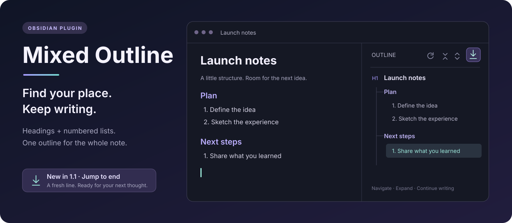

<p align="center"></p>

<h1 align="center">Mixed Outline · 混合大纲</h1>
<p align="center">把标题和有序列表放进同一棵大纲树。光标点到哪里，大纲就跟到哪里。</p>
<p align="center"><a href="README.md">English</a> · <a href="https://github.com/hemashishi12/mixed-outline/releases/latest">最新版本</a> · <a href="CHANGELOG.md">更新记录</a></p>

## 为写作结构而生

读书笔记、学习提纲、项目计划和长文草稿，常常同时使用标题与编号列表。Mixed Outline 把它们组合在右侧栏，点击即可定位到原文。

- **混合大纲**：同时展示标题、有序列表及嵌套层级。
- **跟随光标**：点击、方向键移动或输入时，展开光标对应的大纲分支。
- **滚动到顶部**：一步到达文首并聚焦光标，不修改正文。
- **跳转到最后**：一步到达文末，把光标放在空行，立即接着写。
- **自定义快捷键**：顶部和底部命令均可在 Obsidian「设置 → 快捷键」中单独绑定或修改。
- **跟随阅读位置**：可选的滚动同步会展开当前路径、高亮当前位置。
- **展开与折叠**：工具栏一键整理大纲。
- **实时刷新**：编辑内容或切换笔记时自动更新。

上方为使用虚构内容制作的示意图。仓库不包含私人知识库截图。

## 安装与更新

### 1.3.0 更新亮点

- **一键滚动到顶部**：工具栏首个按钮改为顶部定位，聚焦第一行开头，不修改正文；手动刷新保留在命令面板。
- **顶部、底部快捷键分别配置**：在「设置 → 快捷键」中搜索 Mixed Outline，即可绑定或修改两个命令的快捷键。
- **保留已有习惯**：底部命令 ID 和已绑定快捷键保持不变，继续按需补一个换行并聚焦空白末行。

升级保留已有设置。查看[本次 Release](https://github.com/hemashishi12/mixed-outline/releases/tag/1.3.0) 或[完整更新记录](CHANGELOG.md)。

### 安装方法

1. 打开 Obsidian **设置 → 第三方插件 → 浏览**。
2. 搜索 **Mixed Outline**，安装并启用。
3. 点击左侧功能区的插件图标，或在命令面板运行 **Mixed Outline: Open mixed outline**。

已安装的用户可在第三方插件设置中点击 **检查更新**。

手动安装：从[最新 Release](https://github.com/hemashishi12/mixed-outline/releases/latest) 下载 `main.js`、`manifest.json`、`styles.css`，放入 `<你的库>/.obsidian/plugins/mixed-outline/`，重载 Obsidian 后启用。升级时保留存储个人设置的 `data.json`。

最低要求为 **Obsidian 1.5.0**。插件使用 Obsidian 及其内置 CodeMirror API，无 Node.js / Electron 运行时依赖，声明兼容桌面端和移动端。本次 1.3.0 已在桌面端实测；移动端和最低兼容版本尚未单独验证。

## 跟随光标

在**实时预览**或**源码模式**中点击标题、编号条目或正文，大纲会高亮对应节点，展开该节点及其祖先，折叠其他分支。选中父标题或父列表项时，会显示它的直接子项。方向键移动和编辑同样有效，不需要滚动页面。

普通段落对应它前面的标题或列表节点；第一条大纲之前的正文没有可高亮的节点。

**Follow cursor / 跟随光标** 默认开启，升级后也会开启。它与 **Auto sync to scroll position** 独立，后者默认关闭；需要边滚动边跟随时可自行开启。阅读模式没有编辑光标，使用滚动同步定位。

若希望完全手动展开和折叠大纲，将这两个开关都关闭即可。

## 滚动到顶部和底部

工具栏最左侧的 **向上箭头指向横线** 按钮替代原来的 Refresh 按钮，悬浮提示为 **滚动到顶部 / Jump to start**。点击后激活当前笔记编辑器，将光标放到第一行开头并滚动到顶部，不修改正文；阅读模式会先切换到编辑状态。手动刷新仍可通过命令面板的 **Mixed Outline: Refresh mixed outline** 执行。

### 自定义快捷键

打开 **设置 → 快捷键**，搜索 **Mixed Outline**，分别为以下命令添加或修改快捷键：

- **Jump to start / 滚动到顶部**
- **Jump to end / 跳转到最后（滚动到底部）**

使用 Obsidian 自带的快捷键配置，默认不预设组合键。原有底部命令 ID `mixed-outline:jump-to-end` 保持不变，已配置的快捷键继续有效。即使大纲侧栏关闭，也可通过快捷键或命令面板执行。没有可用 Markdown 笔记时，两个工具栏按钮均不可用。

### 跳转到最后

工具栏最右侧的 **向下箭头落到横线** 按钮，悬浮提示为 **跳转到最后 / Jump to end**。

点击后，插件激活当前笔记的编辑器，滚动到文末并聚焦光标：

| 笔记状态 | 点击后的行为 |
| --- | --- |
| 最后一行有文字 | 在末尾补一个换行，光标放到新行开头。 |
| 已有空白末行 | 直接将光标放到该行，反复点击不会堆积空行。 |
| 空笔记 | 在第一行直接开始输入。 |
| 阅读模式 | 先切换到编辑状态，再定位文末。 |
| 末尾是编号列表或有选中文本 | 保留原文，追加换行时不会删除选中内容或自动补列表编号。 |

命令面板与自定义快捷键的行为和工具栏按钮一致。

## 大纲识别规则

支持 `#` 到 `######` 的 ATX 标题，以及 `1.`、`2)` 等有序列表标记。编号条目按所属标题和缩进组织层级。

```markdown
# 项目
1. 第一步
   1. 细节
### 下一节
1. 下一步
```

对应大纲：

```text
项目
├─ 1. 第一步
│  └─ 1. 细节
└─ 下一节
   └─ 1. 下一步
```

标题在前时，列表属于该标题，与下一级标题并列。标题在后时，按标题关系挂载，不会成为前面列表的子项。即使从一级跳到三级标题，「下一节」仍与「第一步」并列。第一个标题之前的列表与该标题同处根层级。

跳过 YAML 属性区、围栏代码块、无序列表、任务列表，以及藏在无序列表或任务列表下面的编号条目。

## 设置

| 设置 | 默认值 | 作用 |
| --- | --- | --- |
| Show headings | 开 | 显示标题。 |
| Show ordered lists | 开 | 显示有序列表。 |
| Strip Markdown formatting | 开 | 简化标签中的 Markdown 标记。 |
| Maximum item length | 160 | 限制标签长度，可设为 20–500。 |
| Open on startup | 关 | 启动时自动打开大纲。 |
| Follow cursor / 跟随光标 | 开 | 立即高亮并展开光标对应的节点及其祖先。 |
| Auto sync to scroll position | 关 | 跟随正文滚动，展开当前位置的祖先路径并折叠其他分支。 |

## 隐私与开发

笔记内容只在本地处理，无网络请求、遥测或账户要求。设置保存在插件的 `data.json` 中；“跳转到最后”只会在需要时为目标笔记追加一个换行。

这是一个可直接编辑的 JavaScript 插件，不需要构建或安装依赖。使用 Node.js 18+ 执行：

```sh
node --check main.js
node --test
```

修改后将三个插件文件复制到测试库并重载插件。架构说明、维护经验和发布方式见 [English README 的 Development 部分](README.md#development)。Release 标签必须与清单版本一致且不带 `v` 前缀；为已有插件发布更新无需重新提交市场收录申请。

欢迎[反馈问题](https://github.com/hemashishi12/mixed-outline/issues)，请附上版本号与不含私人内容的最小复现示例。

[MIT License](LICENSE)
